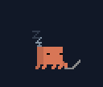
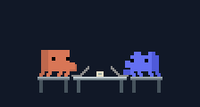
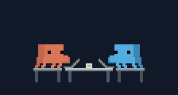
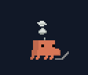
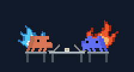
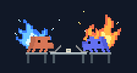

# AgentPet

**Claude·Codex의 작업 수에 맞춰 타이핑하고, 쉬고, 불타는 macOS 데스크톱 친구.**

Clawd, Cody, 한 책상에서 함께 일하는 두 캐릭터 중에서 고를 수 있습니다. 작업이 없으면 눈을 감고 쉬고, 바빠질수록 연기와 불꽃이 커집니다.

| 0개 · 휴식 | 1–2개 · 여유 | 3–4개 · 집중 |
| :---: | :---: | :---: |
|  |  |  |
| **5–6개 · 연기** | **7–9개 · 불꽃** | **10개 이상 · 더 큰 불꽃** |
|  |  |  |

함께 모드의 실제 애니메이션입니다. Clawd·Cody를 각각 표시할 수도 있습니다.

## 설치

[최신 버전 다운로드](https://github.com/tinkerer0/agent_pet/releases/latest) → ZIP을 풀고 `AgentPet.app`을 실행하세요.

macOS 13 이상용으로 빌드합니다. Apple Silicon에서 실행을 확인했으며, Intel은 빌드 검증만 했습니다. 배포 앱은 ad-hoc 서명이며 Apple 공증을 받지 않았습니다. macOS가 실행을 차단하면 직접 빌드해서 사용할 수 있습니다.

Xcode Command Line Tools가 있다면 저장소만으로 빌드할 수 있습니다. 캐릭터 에셋도 포함되어 있습니다.

```sh
git clone https://github.com/tinkerer0/agent_pet.git
cd agent_pet
bash scripts/build.sh
open dist/AgentPet.app
```

## 사용법

- **드래그:** 위치 이동. 위치와 크기, 선택한 캐릭터는 다음 실행에도 유지됩니다.
- **우클릭 또는 메뉴 막대:** 캐릭터·크기 변경, 단계 미리보기, 자동 감지, 종료.
- **함께 모드:** Clawd와 Cody가 한 책상에서 서로 다른 박자로 타이핑합니다.
- **투명한 여백:** 아래에 있는 앱을 그대로 클릭할 수 있습니다.

| 작업 중인 세션 | 모습 |
| --- | --- |
| 0 | 손을 내리고 눈을 감은 채 휴식 · 떠오르는 zzz |
| 1–2 | 여유롭게 타이핑 |
| 3–4 | 집중해서 타이핑 |
| 5–6 | 빠른 타이핑 · 연기 |
| 7–9 | Clawd 파란 불꽃 · Cody 주홍 불꽃 |
| 10 이상 | 더 큰 불꽃과 불티 · 일렉트릭 블루 / 코랄·레몬빛 |

두 에이전트의 **전체 작업 수**에 반응합니다. 2초마다 확인하고, 낮아진 단계는 4초간 유지될 때 전환합니다. ‘자동 · 실제 작업 수’를 선택하면 미리보기를 끝냅니다.

## 감지와 개인정보

Codex의 열려 있는 로컬 세션 로그와 Claude Code의 로컬 상태 파일을 읽습니다. API 키, 후크 설치, 네트워크 연결이 필요하지 않습니다. 대화 내용을 별도로 저장하거나 전송하지 않습니다.

감지는 현재 CLI의 기록 형식에 의존합니다. 형식이 바뀌거나 필요한 상태 파일이 없는 환경에서는 수가 다를 수 있습니다. 원격 컴퓨터·다른 에이전트 도구는 포함하지 않습니다. [감지 방식과 저장 정보](PRIVACY.md)

```sh
bash scripts/test.sh
dist/AgentPet.app/Contents/MacOS/AgentPet --status
```

[빌드·에셋 구조](DEVELOPMENT.md)

## Feedback

제가 이런 분야를 접한 지 얼마 안 돼서 부족한 점이 많습니다. 고칠 점이나 알려주실 내용이 있다면 issue나 PR로 남겨주시면 너무 감사하겠습니다.

## License

코드는 [MIT](LICENSE)입니다. Clawd와 Cody의 캐릭터 디자인은 MIT에 포함되지 않습니다. 이 앱은 Anthropic·OpenAI와 관계없는 개인 프로젝트입니다. [캐릭터 고지](THIRD_PARTY_NOTICES.md)
